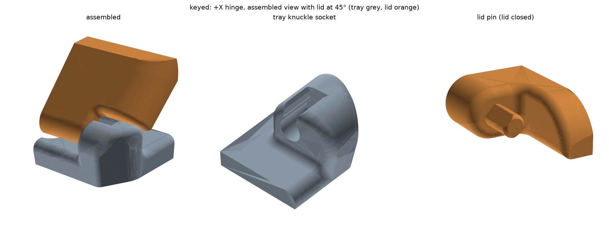
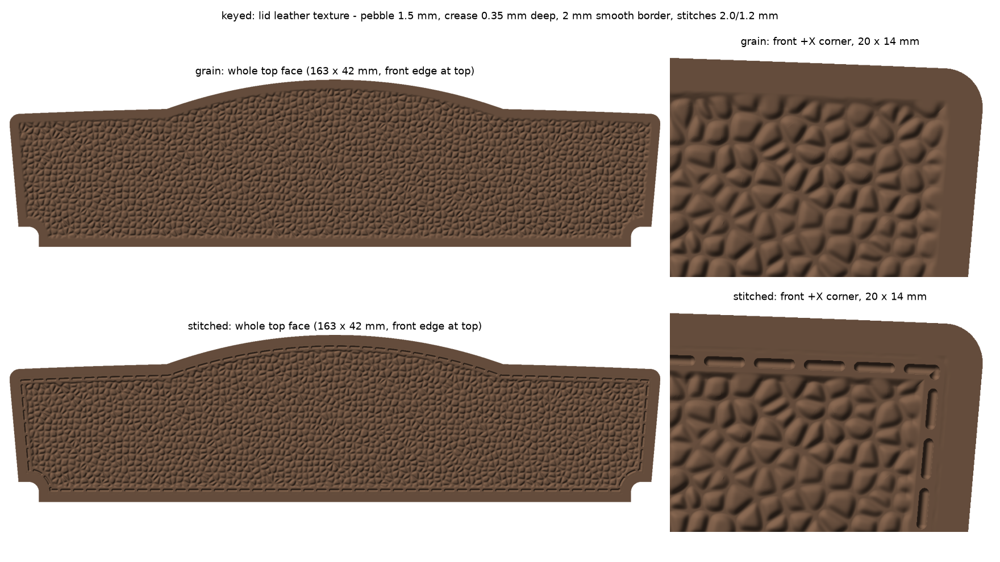

# Kia Sorento Coin Box — rod-free hinge

A 3D-printable coin and mechanical-key holder for the Kia Sorento. It is a tray with a hinged lid, about 175 × 48 mm. The original model needs two Ø2.41 mm metal rods for its hinge. This repo replaces them with printed hinges, offered in three variants, and adds an optional leather texture to the lid.



## Hinge variants

| Variant | How it works | What to print |
|---|---|---|
| **keyed** | The lid has flatted pins. They drop into slotted knuckles only while the lid is held open at 45°, and a narrow neck clicks them into place. At any other angle the lid can't come out. | `coin_keyed_tray.stl` + one `coin_keyed_lid_<style>.stl` |
| **snap** | Round lid pins press through a narrow throat into C-shaped sockets. | `coin_snap_tray.stl` + one `coin_snap_lid_<style>.stl` |
| **print_in_place** | Cone pins sit in cone sockets with 0.35–0.4 mm clearance. The box prints already assembled, with the lid open at 90°. | one `coin_print_in_place_<style>.stl` |

The lid opens to 96° in every variant.

## Lid texture

The lid's flat top is debossed with a leather texture in one of two styles:

- **grain** — Voronoi pebbles, about 1.5 mm across and 0.35 mm deep.
- **stitched** — the same grain plus a dashed stitch line 3 mm inside the edge.



The texture is cut into the surface and never raised, so it doesn't affect hinge clearances. A 2 mm border is left smooth. To get crisp grain, print the lid with fine layers, around 0.12 mm.

## Files

```
coin.STEP                    original model (SolidWorks 2024 export, inches) — never modified
make_rodless_hinge.py        generator + geometric checks (CadQuery)
rodless/<variant>/
  coin_<variant>.step                 both bodies, smooth (no texture)
  coin_<variant>_tray.stl             keyed / snap
  coin_<variant>_lid_<style>.stl      keyed / snap — style = grain | stitched
  coin_print_in_place_<style>.stl     print_in_place, assembled
  coin_<variant>_<style>.glb          animated assembly (opens / closes)
  coin_<variant>_hinge.png            hinge close-up
  coin_<variant>_leather.png          texture relief preview
```

GitHub's built-in viewer shows the STLs in 3D. To watch the GLBs animate, open them in a glTF viewer such as Windows 3D Viewer, Blender, or [gltf-viewer.donmccurdy.com](https://gltf-viewer.donmccurdy.com/).

The STL, STEP and GLB files are stored with **Git LFS**. Install it (`git lfs install`) before cloning, or the files arrive as pointer stubs.

## Regenerating

You need Python with `cadquery`, `trimesh` and `matplotlib`:

```sh
pip install cadquery trimesh matplotlib
python make_rodless_hinge.py                  # all variants
python make_rodless_hinge.py keyed snap       # selected variants
```

Every fit dimension, including pin diameter, socket clearance, keying angle and texture depth, is a constant at the top of the script. Edit them there to tune the hinge for your printer. The script prints PASS/FAIL for each geometric check (interference, clearance, retention, wall thickness) and exits with status 1 if any check fails.
